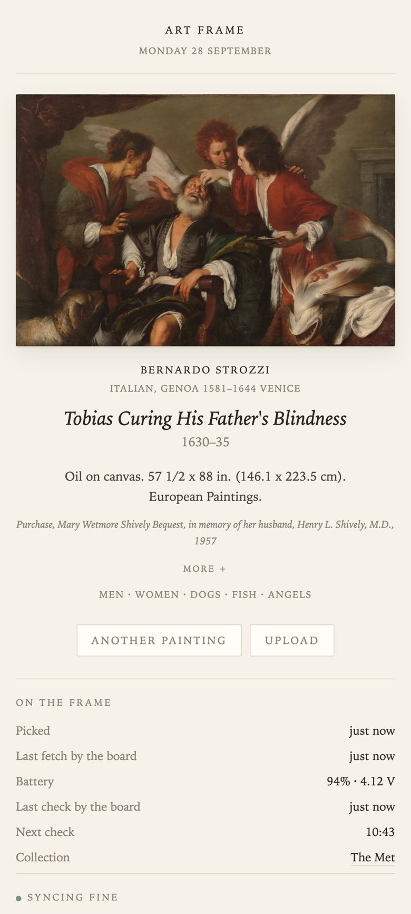

# spectra6

A tool for getting the best possible image out of an E Ink Spectra 6 panel.

The panel prints six pigments. Its white is a light grey, its black is a dark grey, and every colour in between is a dither pattern of the six. Feed it an image straight from a camera and you get mud. This tool measures each image against what your panel can really reproduce, boosts the hues that fall short, compresses the tones and colours the panel cannot reach, and dithers the result onto the six inks.

## Install

```
go install github.com/TjarcoKerssens/spectra-6-paintings/cmd/spectra6@latest
```

Or from a clone, `make install` builds with Go 1.26 and puts the binary in `~/bin`. `make install PREFIX=/usr/local` puts it somewhere else.

## Use

```
spectra6 photo.jpg              tune interactively, s saves
spectra6 *.jpg                  same, n and p walk the set
spectra6 -batch *.jpg           convert everything and exit
spectra6 -dry-run photo.jpg     print the analysis, write nothing
spectra6 -calibrate             measure your own panel
```

When stdin or stdout is not a terminal it drops to batch on its own, so pipes and scripts keep working.

The interactive view shows a simulation of the panel while you adjust knobs. In iTerm2 and WezTerm the preview is drawn with real pixels through the inline image protocol; other terminals get a coarse half block rendering. Arrow keys pick and change a setting, `v` cycles between the simulation, the device colours and the source, `O` opens the preview in your image viewer, `s` writes the result at full panel resolution. Output lands in `./epaper` as an indexed PNG in the firmware ink order black, white, yellow, red, blue, green. Pass `-bmp` for 24 bit BMP and `-sim` to also write a preview of what the panel will show.

## Calibrate

Every unit mixes its pigments a bit differently, and every decision this tool makes derives from six measured colours. Calibrating beats any knob. Run `spectra6 -calibrate` and follow the steps. It writes a test target for your panel, you photograph it under even light with a sheet of white paper in frame, and the tool computes your palette from the photo. The result is saved to `~/.config/spectra6/palette.json` and used from then on.

Until you calibrate, a built in measurement of a 7.3 inch panel is used. It is close, not exact.

## How it works

The image is fitted to the panel, then analysed per hue. Where the image is less colourful than the panel can manage, chroma is raised toward the gamut edge. Where it is more colourful, gamut compression folds it back. Tone compression maps the image's range onto the panel's real black to white span, and an error diffusion dither, Burkes by default, mixes the six inks. Matching happens in OkLab so "nearest ink" means what the eye means. Flat graphics are detected and left alone, since their colours are already deliberate.

Run `spectra6 -h` for the full flag list.

## Art frame

`frame/` turns an XIAO EE02 with the 13.3 inch panel into a frame that shows a new painting every morning. A Mac or Linux box on the same network serves a random, colourful landscape painting from the Met, the Art Institute of Chicago or the Cleveland Museum of Art, picked through their open APIs and prepared with this tool. Which museums and which kinds of art is set in `frame/sources.yaml`. The board runs ESPHome and checks in every 10 minutes by day, so a new picture from the web app shows up quickly and the battery still lasts months. The same server hosts a small web app showing what is on the wall, whether the board is still syncing, and buttons to pick another painting or upload your own. All settings, from the wifi to the schedule, live in `.env`, see [.env.example](.env.example). Setup and flashing are in [frame/README.md](frame/README.md).



## Development

`make` formats, vets, tests and builds. `make race` runs the tests with the race detector, since the preview renders on a background goroutine. A golden test locks in the ink mix for `testdata/sample.png`, so a change to the pipeline's character fails loudly. Regenerate it with `UPDATE_GOLDEN=1 go test ./...` after looking at the output.

## Credits

- The paintings come from the open access APIs of [The Met](https://metmuseum.github.io/), [the Art Institute of Chicago](https://api.artic.edu/docs/) and [the Cleveland Museum of Art](https://openaccess-api.clevelandart.org/). Their data and public domain images are CC0. The Art Institute also serves small images of work still under copyright, which the frame shows for private viewing only. Descriptions without a museum text come from [Wikipedia](https://en.wikipedia.org/) through [Wikidata](https://www.wikidata.org/), under CC BY-SA, and the web app links back to the article.
- The painting in the screenshot is Bernardo Strozzi's [Tobias Curing His Father's Blindness](https://www.metmuseum.org/art/collection/search/437763), public domain, from The Met.
- The board uses [esphome-epaper-spectra6-133](https://github.com/philippwaller/esphome-epaper-spectra6-133) by Philipp Waller for the display.
- The terminal UI is built on [Bubble Tea, Bubbles and Lip Gloss](https://github.com/charmbracelet) by Charm, image scaling on [imaging](https://github.com/disintegration/imaging) and [golang.org/x/image](https://pkg.go.dev/golang.org/x/image).
- The colour metric in `frame/daily_art.py` is from Hasler and Süsstrunk, "Measuring colourfulness in natural images" (2003). OkLab is by Björn Ottosson.

## License

[MIT](LICENSE). Copyright (c) 2026 Tjarco Kerssens.
